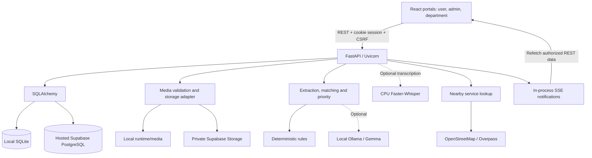
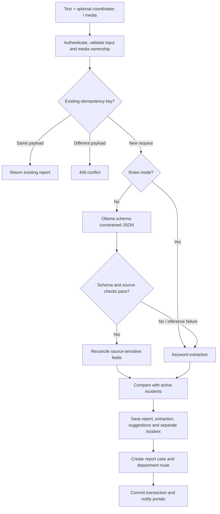
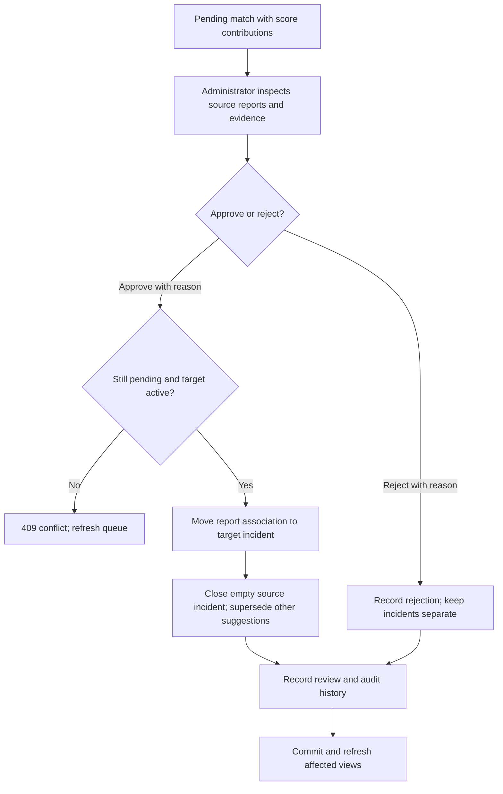
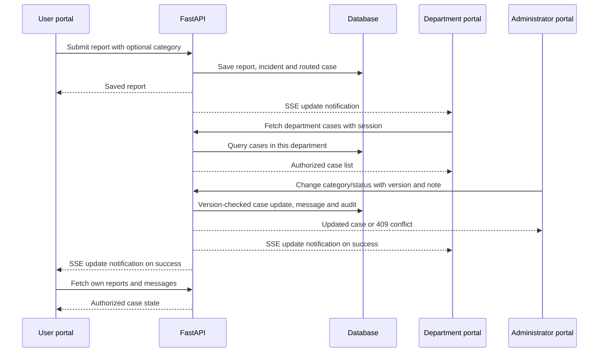
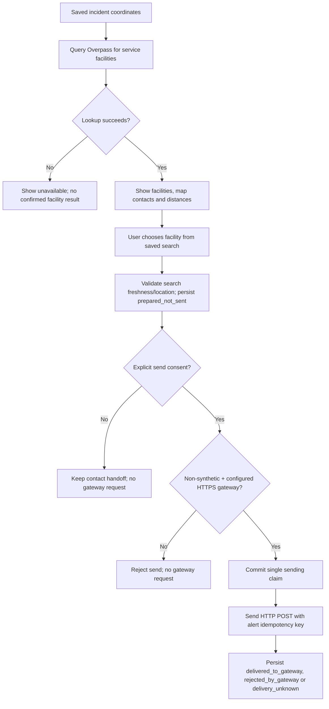

# RESQNET

**When every second matters, turn scattered emergency reports into coordinated action.**

<p align="center">
  <a href="https://resqnet-7w72.onrender.com/">
    
  </a>
</p>

A local disaster-report workspace with user, administrator and department portals. It accepts English, Bengali and Hindi reports, preserves evidence, suggests related incidents, and gives a human reviewer the final say. This is a research demonstration, not an emergency dispatch service or validated triage system.

## Deployment

- **Live app:** [resqnet-7w72.onrender.com](https://resqnet-7w72.onrender.com/)
- **Hosting:** Render free Docker web service. The React/Vite frontend is built into the same container as the FastAPI backend. Render health-checks `/api/health`.
- **Database:** Supabase PostgreSQL, configured on Render with the secret `RESQ_DATABASE_URL`.
- **File storage:** Supabase Storage in the private `resqnet-private` bucket.
- **Runtime settings:** The hosted app uses deterministic `rules` extraction. Voice processing is disabled and no responder gateway is configured.
- **Deploy updates:** Push to `main`; Render automatically builds and deploys the commit. Database URLs, storage keys and bootstrap passwords stay in Render's environment settings, never in this repository.
- **Free-tier behavior:** Render may spin the service down while idle, so the first request after a pause can take longer.

This is a research demo, not an official emergency service. Nearby lookup depends on public map providers and can be temporarily unavailable.

## What works

- Private user accounts, administrator login, individual case categories, critical-first review queues, assignment, shared status updates and two-way case messages. See [portal and database guide](docs/PORTALS.md).
- Admin-issued department logins with server-enforced case routing: Women’s Safety, Fire & Rescue, Health, Police, Disaster Management and Municipal Services. Unclear categories route to Police. New assigned cases open in a live department desk; status notes and evidence remain attached to each case.
- React operations dashboard with actual database metrics, an interactive Leaflet map, incident filters, solved cases with explanations, activity history, analytics and service health.
- Text reports with optional coordinates, automatically recorded observation time, affected-person count and requested assistance. Unknown coordinates stay unknown.
- Local Gemma through Ollama, schema-validated JSON and conservative checks on evidence and safety-sensitive fields. Every report records its actual extraction engine and processing time.
- Explicit deterministic fallback for unavailable or invalid model responses, with English/Bengali/Hindi keyword support.
- Weighted match suggestions with individual contributions. Reports always begin as separate incidents. Human approval is required for linking.
- Priority explanations, source references and conflicts. Repeated reports do not establish independent corroboration.
- Approval, rejection, correction, manual merge, separation, and verification flags with transaction-backed review records and audit history.
- Validated image uploads and metadata-free previews. Optional CPU Faster-Whisper transcription; users can edit transcripts before submission.
- A reproducible 30-report fictional dataset, 10 incident groups, separately stored labels and an executable evaluation script.
- Nearby police, fire/rescue and medical lookup using OpenStreetMap; permission-based live browser location, straight-line distances, directions, and persistent contact alerts. Car theft suggests police. External alert delivery requires a specifically authorized station gateway and explicit send consent; no station is connected by default. See [Nearby Help](docs/NEARBY-HELP.md).

## Tech stack in depth

RESQNET is a Python API and a React single-page application. The same business logic supports a local SQLite workspace and a hosted PostgreSQL deployment. AI inference, voice transcription and external responder delivery are optional integrations, not prerequisites for submitting text reports.

Versions below are **declared dependency versions**, taken from [frontend/package.json](frontend/package.json), [backend/requirements.txt](backend/requirements.txt) and [backend/requirements-voice.txt](backend/requirements-voice.txt). Frontend ranges are resolved by `package-lock.json`; this table does not establish which versions are currently running on Render.

| Layer | Technology | Role in this repository |
| --- | --- | --- |
| Browser application | React `^19.1.0`, React DOM `^19.1.0`, TypeScript `~5.8.3` | Typed user, administrator and department interfaces; forms, case conversations, incident review and dashboard state. |
| Frontend build | Vite `^8.3.4`, React Vite plugin, Node 24 | Development server proxies `/api` to FastAPI; production builds compile TypeScript and generate static assets, with separate map and chart chunks. |
| Styling and UI | Tailwind CSS `^4.1.7`, custom CSS, Radix Slot, class-variance-authority, clsx, tailwind-merge, Lucide React | Utility styles, portal layouts, reusable button variants, class composition and icons. The repository contains a shadcn-style button, not a dependency on a complete shadcn component package. |
| Maps and charts | Leaflet `^1.9.4`, React Leaflet `^5.0.0`, Recharts `^3.10.1` | Geographic incident/case views and database-derived dashboard charts. OpenStreetMap supplies online map tiles. |
| API runtime | Python 3.12, FastAPI `0.143.0`, Starlette `1.7.0`, Uvicorn `0.54.0` | REST endpoints, middleware, authenticated event streams and ASGI serving. FastAPI also exposes OpenAPI documentation at `/docs`. |
| Validation and configuration | Pydantic `2.14.0`, pydantic-settings `2.15.0`, python-multipart `0.0.32` | Request/output schemas, environment settings with the `RESQ_` prefix, and multipart uploads. |
| Persistence | SQLAlchemy `2.1.4`, SQLite; PostgreSQL via psycopg `3.2.6` | ORM models, transaction scopes and database queries. SQLite is the local default; the README documents Supabase PostgreSQL for the hosted app. |
| Report intelligence | Ollama with configurable Gemma, Python keyword rules, RapidFuzz `3.14.6` | Optional local structured extraction, deterministic fallback, lexical matching and explained review priority. No embedding model or vector database is used. |
| Media | Pillow `12.3.0`; optional PyAV `16.0.1` and Faster-Whisper `1.2.1` | Image validation/re-encoding, recording validation and optional CPU transcription. Media bytes use local files or private Supabase Storage through HTTP. |
| External HTTP | HTTPX `0.28.1` | Calls Ollama, Overpass, Supabase Storage and explicitly configured HTTPS responder gateways. |
| Verification | pytest, Ruff, mypy, Vitest, Testing Library, ESLint, Playwright, pip-audit | Backend tests/static checks, frontend component checks, browser journeys and manual dependency-audit commands. |
| Packaging and hosting | Docker, Docker Compose, Nginx, GitHub Actions; documented Render deployment | Combined hosted image or separate local API/frontend containers; CI verifies backend and frontend changes. |

### Frontend and live state

[PortalApp.tsx](frontend/src/PortalApp.tsx) handles session restoration and portal selection. [App.tsx](frontend/src/App.tsx) provides the operations dashboard; components implement submission, review, evidence, nearby help and department case work. [api.ts](frontend/src/api.ts) uses the browser Fetch API with same-origin cookies, a CSRF header and normalized error messages.

Live updates use **Server-Sent Events (SSE)** through `EventSource("/api/live")`, not WebSockets. The backend emits small `ready`/`update` notifications, and the frontend refreshes authorized data through REST. Events do not contain report bodies. [live.py](backend/live.py) keeps bounded subscriber queues in process memory, so multiple API workers would need a shared event broker to notify all clients consistently.

### API, access control and persistence

[main.py](backend/main.py) assembles report, incident, matching, media, analytics and nearby-service endpoints. [portal.py](backend/portal.py) handles cases, messages and department accounts. [auth.py](backend/auth.py) uses Python's `hashlib.scrypt` for password hashes and opaque cookie sessions whose token hashes are stored in the database. Write requests check session CSRF tokens; cookie security is configurable with `RESQ_SECURE_COOKIES`. Server-side ownership and role checks control report/media access and department case scope. Supabase is used for database/storage infrastructure, not Supabase Auth.

[db.py](backend/db.py) separates source reports, extraction results, incidents, associations and match suggestions. Additional tables preserve reviews, audit events, accounts, sessions, cases, messages, media ownership, service searches and responder alerts. A case belongs to a report; an incident can group several reports after human approval. These are distinct workflows, not interchangeable status records.

Database sessions commit successful operations and roll back exceptions. Report idempotency keys are scoped to the account and paired with a payload hash: repeating the same request returns the existing report, while changing its payload under the same key returns a conflict. Case updates use version-checked writes to reject stale edits. Local SQLite enables foreign keys and WAL; hosted PostgreSQL uses the same ORM through psycopg. Startup creates missing tables and applies the repository's department-routing migration helper; there is no Alembic migration framework.

### Extraction, matching and priority

[intelligence.py](backend/intelligence.py) sends report JSON to Ollama's `/api/chat` with the Pydantic extraction schema, temperature zero and a non-streaming response. The default model is `gemma3:1b`. Returned JSON must validate, and evidence spans must be exact source substrings. Safety-sensitive counts and flags are reconciled with conservative rule extraction; model summaries/categories remain unverified interpretations.

`RESQ_AI_MODE=rules` skips inference. Both `auto` and `ollama` can fall back to English/Bengali/Hindi keyword rules when inference fails or output is rejected. The stored extraction engine and latency describe what actually ran. The hosted configuration documented above uses rules; Gemma is a local optional capability.

Matching combines Haversine distance, category equality, RapidFuzz token-set overlap and observation-time proximity. Missing inputs contribute zero. [service.py](backend/service.py) compares against existing active incidents and stores suggestions above the configured threshold, while always creating a separate incident for a new report. A human must approve linking. Priority is a separate rules-based calculation with source references and conflict notes; it is not model confidence or validated medical triage.

### Media, location and external services

[media.py](backend/media.py) verifies image formats, applies orientation, resizes and re-encodes clean JPEG pixels to discard embedded image metadata. The upload limit is 10 MB. Recording validation requires the optional PyAV dependency. Faster-Whisper uses the configured multilingual model (default `small`) on CPU with int8, voice activity detection and a lock that allows one transcription at a time. Users must check/edit transcripts before report submission. Images are supporting evidence; no vision model analyzes them.

Browser geolocation is permission-based. [responders.py](backend/responders.py) queries Overpass for nearby OpenStreetMap facilities, normalizes contact details and uses straight-line Haversine distances. Facility records and phone numbers are map data, not verified availability. Preparing an alert stores a contact handoff without sending it. External sending requires explicit consent, a non-synthetic report and an operator-configured HTTPS endpoint for that facility. Gateway acceptance does not establish station acknowledgment or emergency response.

### Build and verification boundaries

The root [Dockerfile](Dockerfile) builds frontend assets with Node 24, copies them into a Python 3.12 image and runs [cloud.py](backend/cloud.py), which serves both the API and static frontend from one origin. [docker-compose.yml](docker-compose.yml) instead runs FastAPI and an Nginx frontend separately, with a persistent SQLite/media volume and loopback-bound ports.

[GitHub Actions](.github/workflows/tests.yml) runs backend pytest, Ruff, mypy and evaluation, plus frontend lint, unit tests and a production build. Playwright browser tests and dependency audits are available separately; the workflow does not currently run them. See [verification notes](docs/VERIFICATION.md) for recorded checks and their limits.

## Architecture and flow diagrams

These diagrams describe the checked-in implementation. The hosted infrastructure follows the deployment settings documented in this README; optional integrations are labeled explicitly.

### System architecture



SQLite/local files and PostgreSQL/private storage are configuration alternatives, not mirrored replicas. In local development Vite proxies API requests; the hosted container serves built assets directly.

### Report submission and extraction



Invalid model output can receive one retry before fallback. Engine/latency and uncertainty are stored with extraction. Submitting a report does not automatically merge incidents or contact responders.

### Human review of related reports



Manual incident merging and report separation are also available. Linking reports changes the grouping, not the independence or truth of their sources.

### Case routing and live portal updates



Initial routing uses the submitted category when present, otherwise the extracted type. Administrator recategorization updates department routing. Fire routes to Fire & Rescue, medical to Health, flood to Disaster Management, infrastructure to Municipal Services, women's safety to Women's Safety, and crime/unknown to Police. Department routing is an internal access rule; it does not enroll or notify real emergency agencies.

### Nearby help and optional gateway handoff



A delivery attempt is claimed before network I/O to prevent duplicate attempts. Network failure leaves delivery uncertain; a successful gateway HTTP response is not proof of dispatch.

```text
backend/           API, models, extraction, matching, priority, media validation
frontend/          React UI, Tailwind, shadcn-style button, Leaflet, Recharts
data/              Fictional reports, separately held labels, silent audio fixture
scripts/           Seed/reset, evaluation, dataset/audio generation
tests/             Backend and integration tests
docs/              API, demo, attribution, verification, screenshots
.github/workflows/ Backend and frontend CI
```

## Local setup: Windows PowerShell

Prerequisites: Python 3.12 and Node 24. Run from this repository root. All setup and run commands below use only local ports.

```powershell
py -3.12 -m venv .venv
.\.venv\Scripts\python.exe -m pip install --upgrade pip
.\.venv\Scripts\python.exe -m pip install -r backend/requirements.txt
Copy-Item .env.example .env
npm.cmd --prefix frontend ci
.\.venv\Scripts\python.exe -m scripts.seed
```

Start the backend in terminal 1:

```powershell
.\.venv\Scripts\python.exe -m uvicorn backend.main:app --host 127.0.0.1 --port 8000
```

Start the frontend in terminal 2:

```powershell
npm.cmd --prefix frontend run dev
```

Create the first administrator with `.\.venv\Scripts\python.exe scripts/create_admin.py --generate`. Its generated password is written to the ignored local file `runtime/admin-credentials.txt`. Additional administrators can be created with `--email name@example.com` using an interactive password prompt. Public registration always creates a user account.

Open [the user portal](http://127.0.0.1:5173/#user), [admin sign-in](http://127.0.0.1:5173/#admin), or [interactive API documentation](http://127.0.0.1:8000/docs). The permanent local database is `runtime/resq.db`, uploads are in `runtime/media`. Restarting either server preserves accounts, reports and conversations. Back it up with `.\.venv\Scripts\python.exe scripts/backup_database.py`; copy the media folder separately. The initial seed command refuses to overwrite existing incidents.

## Local setup: macOS / Linux

```bash
python3.12 -m venv .venv
source .venv/bin/activate
python -m pip install --upgrade pip
pip install -r backend/requirements.txt
cp .env.example .env
npm --prefix frontend ci
python -m scripts.seed
uvicorn backend.main:app --host 127.0.0.1 --port 8000
# In another terminal, from the repository root:
npm --prefix frontend run dev
```

## Local models and fallback

Install [Ollama](https://ollama.com), then:

```text
ollama pull gemma3:1b
```

Ollama's desktop service normally starts automatically. Otherwise run `ollama serve` in another terminal. `RESQ_AI_MODE=auto` attempts Gemma and falls back on service failure or rejected output. `RESQ_AI_MODE=rules` forces a reproducible offline demonstration. `RESQ_AI_MODE=ollama` also safely falls back if inference fails; it does not guarantee successful model output. The actual engine is always stored on each report.

Gemma 3 1B uses roughly 806 MB of downloaded weights. It is the low-memory baseline; Bengali/Hindi extraction quality must not be assumed. For a stronger multilingual option, install `gemma3:4b` and change `RESQ_OLLAMA_MODEL`, subject to available RAM. Both variants use Gemma's separate license. Review the [Gemma terms](https://ai.google.dev/gemma/terms).

The default Ollama timeout is 40 seconds per attempt. A cold load may time out and produce a labeled rules result. Warm the model with `ollama run gemma3:1b "Reply READY"` before a live demonstration, or adjust `RESQ_OLLAMA_TIMEOUT`. Malformed JSON receives one retry; connection failures fall back immediately.

Voice is optional:

```powershell
.\.venv\Scripts\python.exe -m pip install -r backend/requirements-voice.txt
```

Set `RESQ_VOICE_ENABLED=true` in `.env`, then restart the backend. The default multilingual Whisper `small` model runs on CPU with int8 and downloads on first use. Internet is required for that initial download. Upload a recording in Submit Report, listen to the preserved audio, correct the generated text, and submit. Recognition is imperfect; no prerecorded transcript is substituted on failure. Uploaded audio can remain attached if transcription fails and the operator types the source text manually.

Generate repeatable inputs:

```powershell
.\.venv\Scripts\python.exe -m scripts.synthetic_audio
powershell -File scripts/synthetic_speech.ps1
```

The first produces a silent WAV for no-speech tests. The second uses the installed Windows speech engine to generate an English fictional report. An original Bengali recording can be made from [the demo script](docs/DEMO.md); none is bundled.

## Dataset, reset and evaluation

```powershell
# Stop the backend first. Replaces all records in the configured app database:
.\.venv\Scripts\python.exe -m scripts.seed --reset
# Empty the configured app database for a three-report demonstration:
.\.venv\Scripts\python.exe -m scripts.seed --reset --blank
# Rebuild the source dataset and separately held ground-truth labels:
.\.venv\Scripts\python.exe -m scripts.generate_data
# Calculate actual extraction and pairwise matching metrics:
.\.venv\Scripts\python.exe -m scripts.evaluate --mode rules
```

The seed uses deterministic extraction and **scripted demonstration approvals**, recorded as such in the audit history. It never reads the ground-truth label file. This produces a useful preloaded dashboard; it is not evidence of real human verification. Every seeded report has `synthetic=true`. Reset removes database records but retains old uploaded files to avoid destructive filesystem deletion.

Evaluation compares all 435 pairs, including 30 true duplicate pairs and 405 nonduplicate pairs. Results are written to `runtime/evaluation-rules.json`; `--mode ollama` runs real local inference and reports any fallback usage. No evaluation metrics are hardcoded into the UI. The curated dataset is small and contains straightforward language and coordinates; performance must not be generalized to operational reports.

Matching uses `0.40 × geography + 0.25 × category + 0.25 × text + 0.10 × observation time`. Geographic similarity decreases linearly to zero at 3 km; time similarity decreases to zero at 24 hours. Missing coordinates or timestamps contribute zero. Unknown categories contribute zero. RapidFuzz measures lexical overlap, not multilingual semantic equivalence. The default suggestion threshold is 0.62, configurable with `RESQ_MATCH_THRESHOLD`. No score triggers automatic merging.

Priority adds 40 for source-supported trapped-person reports, 30 for medical requests, 30 for a reported fire, and 20 for rising water. Scores are capped at 100; high starts at 40 and medium at 20. Unknowns and conflicts remain visible. These weights are prototype review heuristics, not calibrated emergency or medical criteria.

## Verification commands

```powershell
.\.venv\Scripts\python.exe -m pytest -q
.\.venv\Scripts\python.exe -m ruff check backend tests scripts
.\.venv\Scripts\python.exe -m mypy backend
.\.venv\Scripts\python.exe -m pip_audit
npm.cmd --prefix frontend run test
npm.cmd --prefix frontend run lint
npm.cmd --prefix frontend run typecheck
npm.cmd --prefix frontend run build
npm.cmd --prefix frontend audit
```

With both servers running and an administrator created, browser tests submit marked synthetic reports, approve a match and exercise user/admin conversations. Tests use `runtime/admin-credentials.txt`, or `RESQ_TEST_ADMIN_EMAIL` and `RESQ_TEST_ADMIN_PASSWORD`. Use a disposable demo database; never reset a database containing real accounts or reports:

```powershell
Push-Location frontend
npx.cmd playwright install chromium
npm.cmd run test:e2e
Pop-Location
```

See [verification notes](docs/VERIFICATION.md) for the checks executed on the build machine and their limits. Frontend unit tests mock transport deliberately; backend tests and browser journeys exercise real persistence separately.

## Docker Compose

```text
docker compose up --build -d
docker compose exec backend python -m scripts.seed
```

The web app is at `http://127.0.0.1:5173`. SQLite and media use a named volume. Compose defaults to deterministic mode and loopback-only ports. Optional voice dependencies are not installed in the base image. Host Ollama connectivity varies by OS and bind configuration. Docker was not available in the build environment, so these image definitions have not been executed here.

## Limits and next work

- The public demo is deployed, but operational hardening remains unfinished: email verification, password recovery, MFA and formal security review are not configured. Read [SECURITY.md](SECURITY.md) before changing bind addresses.
- No confirmed emergency dispatch, geocoding, external incident feeds or source-identity verification. Coordinates can come from an operator or permission-based browser location and remain unverified. Nearby-service lookup and optional authorized gateway handoff do not establish station acknowledgment or emergency response.
- Rule extraction is intentionally narrow. Negation, spelled-out numbers, ambiguous context and complex multilingual grammar can fail. Model summaries and categories are unverified interpretations. Safety checks reduce hallucination risk, not eliminate it.
- Voice transcription is CPU-bound and serialized. Initial model download may be slow. No Bengali/Hindi audio accuracy benchmark is claimed.
- Images are evidence only; vision analysis is deferred. Audio metadata is preserved, unlike re-encoded image metadata.
- OpenStreetMap tiles need internet. Coordinates and markers still render on an empty map if tiles fail, with an explicit notice; no tiles are cached or bundled.
- The MVP loads all incidents and up to 500 reports in the UI. Matching scans existing active incidents. Larger datasets need pagination, spatial indexing and a job queue.
- Audit events are append-only through the API, not cryptographically tamper-proof. This upgrade adds tables without altering existing reports. Case edits use version checks; broader incident editing still needs careful operator coordination. There is no encryption at rest or automatic retention job.
- Optional vision and operational validation are deferred.

See [API reference](docs/API.md), [three-minute demonstration](docs/DEMO.md), [contribution guide](CONTRIBUTING.md) and [third-party attribution](docs/ATTRIBUTION.md). Original code is [MIT licensed](LICENSE); third-party dependencies and models retain their own terms.
